# Moodle database diagram

This is a high-level view of Moodle's central learning-domain schema. Moodle
stores the core schema in `public/lib/db/install.xml`; activity plugins extend
it with their own `db/install.xml` files, such as
`public/mod/quiz/db/install.xml` and `public/mod/assign/db/install.xml`.

The diagram focuses on the tables most commonly involved in users, courses,
enrolment, activities, questions, groups, files, and grades. Moodle also uses
polymorphic relationships (for example `course_modules.instance`), so some
relationships shown here are logical links rather than database-enforced
foreign keys.

```mermaid
erDiagram
    USER {
        int id PK
        string username
        string email
    }

    COURSE_CATEGORIES {
        int id PK
        int parent FK
        string name
    }

    COURSE {
        int id PK
        int category
        string fullname
        string shortname
        int originalcourseid FK
    }

    CONTEXT {
        int id PK
        int contextlevel
        int instanceid
    }

    ROLE {
        int id PK
        string shortname
        string archetype
    }

    ROLE_ASSIGNMENTS {
        int id PK
        int roleid FK
        int contextid FK
        int userid FK
    }

    ENROL {
        int id PK
        int courseid FK
        int roleid FK
        string enrol
    }

    USER_ENROLMENTS {
        int id PK
        int enrolid FK
        int userid FK
        int modifierid FK
    }

    COURSE_SECTIONS {
        int id PK
        int course
        int section
    }

    MODULES {
        int id PK
        string name
    }

    COURSE_MODULES {
        int id PK
        int course
        int module
        int instance
        int section
    }

    GROUPS {
        int id PK
        int courseid FK
        string name
    }

    GROUPS_MEMBERS {
        int id PK
        int groupid FK
        int userid FK
    }

    QUIZ {
        int id PK
        int course
        string name
    }

    QUIZ_SLOTS {
        int id PK
        int quizid FK
        int slot
    }

    QUIZ_ATTEMPTS {
        int id PK
        int quiz FK
        int userid FK
        int uniqueid FK
    }

    ASSIGN {
        int id PK
        int course
        string name
    }

    ASSIGN_SUBMISSION {
        int id PK
        int assignment FK
        int userid
        int groupid
    }

    QUESTION_CATEGORIES {
        int id PK
        int contextid FK
        int parent FK
        string name
    }

    QUESTION_BANK_ENTRIES {
        int id PK
        int questioncategoryid FK
        int ownerid FK
        int nextversion
    }

    QUESTION {
        int id PK
        int parent FK
        int createdby FK
        int modifiedby FK
        string qtype
    }

    QUESTION_VERSIONS {
        int id PK
        int questionbankentryid FK
        int questionid FK
        int version
    }

    GRADE_ITEMS {
        int id PK
        int courseid FK
        int categoryid FK
        int iteminstance
    }

    GRADE_GRADES {
        int id PK
        int itemid FK
        int userid FK
        decimal finalgrade
    }

    COURSE_COMPLETION_CRITERIA {
        int id PK
        int course
        int moduleinstance
    }

    COURSE_COMPLETIONS {
        int id PK
        int userid
        int course
        int timecompleted
    }

    FILES {
        int id PK
        int contextid FK
        int userid FK
        string contenthash
    }

    COURSE_CATEGORIES ||--o{ COURSE : contains
    COURSE_CATEGORIES ||--o{ COURSE_CATEGORIES : parent
    COURSE ||--o{ COURSE : cloned_from
    COURSE ||--o{ ENROL : offers
    ROLE ||--o{ ENROL : default_role
    ENROL ||--o{ USER_ENROLMENTS : has
    USER ||--o{ USER_ENROLMENTS : enrols
    USER ||--o{ USER_ENROLMENTS : modifies

    COURSE ||--o{ COURSE_SECTIONS : has
    COURSE ||--o{ COURSE_MODULES : contains
    MODULES ||--o{ COURSE_MODULES : identifies
    COURSE_SECTIONS ||--o{ COURSE_MODULES : organises
    COURSE ||--o{ GROUPS : has
    GROUPS ||--o{ GROUPS_MEMBERS : contains
    USER ||--o{ GROUPS_MEMBERS : joins

    ROLE ||--o{ ROLE_ASSIGNMENTS : grants
    CONTEXT ||--o{ ROLE_ASSIGNMENTS : scopes
    USER ||--o{ ROLE_ASSIGNMENTS : receives
    CONTEXT ||--o{ FILES : stores
    USER ||--o{ FILES : owns

    COURSE ||--o{ QUIZ : contains
    QUIZ ||--o{ QUIZ_SLOTS : defines
    QUIZ ||--o{ QUIZ_ATTEMPTS : receives
    USER ||--o{ QUIZ_ATTEMPTS : makes
    COURSE ||--o{ ASSIGN : contains
    ASSIGN ||--o{ ASSIGN_SUBMISSION : receives
    USER ||--o{ ASSIGN_SUBMISSION : submits
    GROUPS ||--o{ ASSIGN_SUBMISSION : submits_as

    CONTEXT ||--o{ QUESTION_CATEGORIES : scopes
    QUESTION_CATEGORIES ||--o{ QUESTION_CATEGORIES : parent
    QUESTION_CATEGORIES ||--o{ QUESTION_BANK_ENTRIES : contains
    USER ||--o{ QUESTION_BANK_ENTRIES : owns
    QUESTION_BANK_ENTRIES ||--o{ QUESTION_VERSIONS : versions
    QUESTION ||--o{ QUESTION_VERSIONS : has
    USER ||--o{ QUESTION : creates
    USER ||--o{ QUESTION : modifies
    QUESTION ||--o{ QUESTION : parent

    COURSE ||--o{ GRADE_ITEMS : grades
    GRADE_ITEMS ||--o{ GRADE_GRADES : records
    USER ||--o{ GRADE_GRADES : receives

    COURSE ||--o{ COURSE_COMPLETION_CRITERIA : defines
    USER ||--o{ COURSE_COMPLETIONS : completes
    COURSE ||--o{ COURSE_COMPLETIONS : tracks

    QUIZ }o--|| COURSE_MODULES : instance
    ASSIGN }o--|| COURSE_MODULES : instance
```

Core table definitions and declared keys:

- `public/lib/db/install.xml`
- `public/mod/quiz/db/install.xml`
- `public/mod/assign/db/install.xml`
